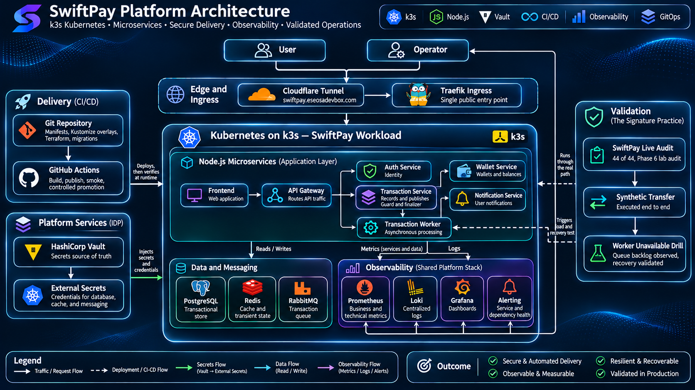
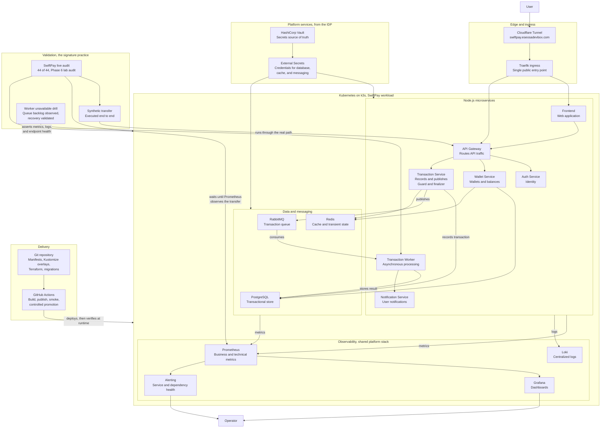
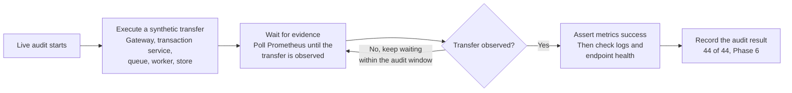

# SwiftPay Platform Architecture

This document is the architecture design of record for SwiftPay as a managed workload of the Internal Developer Platform. The image above is rendered from the Mermaid source in this file, so the picture and the source never drift apart. The service level diagram in the repository README and `docs/architecture.md` remains the reference for ports, routes, and the multi environment deployment paths.

## The design in one paragraph

Users and the operator reach SwiftPay through Cloudflare Tunnel and Traefik ingress, the single public entry point. Inside Kubernetes on k3s, the frontend and API gateway front the Node.js services: auth, wallet, transaction, and notification. The transaction service records each transaction in PostgreSQL and publishes it to RabbitMQ; the transaction worker consumes the queue and processes asynchronously, storing the result and triggering notifications. Redis supports caching and transient state. Credentials for the database, cache, and messaging arrive from HashiCorp Vault through External Secrets, never from manifests. Prometheus, Loki, Grafana, and alerting are the shared platform observability stack, carrying business metrics beside technical metrics. Validation is the signature practice: the live audit executes a synthetic transfer through the real path and waits until Prometheus observes it before asserting success, because metrics for a transfer appear after processing, not at request time (44 of 44 checks passed, Phase 6 lab audit). The transaction worker unavailable drill exercises the queue backlog failure mode on purpose.

## Architecture diagram, Mermaid source

## Flow diagram: the synthetic transfer validation, Mermaid source

## Notes

- SwiftPay is a portfolio application in a lab environment. It is not a regulated financial system, and no compliance, settlement, or real money claims are made.
- Audit counts are point in time lab validation results documented in the platform repository.
- Live application: `https://swiftpay.eseosadevbox.com`.
